<div align="center">


# LBPL Cricket

**The official live-scoring and tournament app for the LBPL (Local Box Premier League).**

Live scores, fixtures, points tables, player stats, team squads and a fan community — in one installable web app.

[](https://lbplofficial.com)
[](#-install-the-app)


<br/>

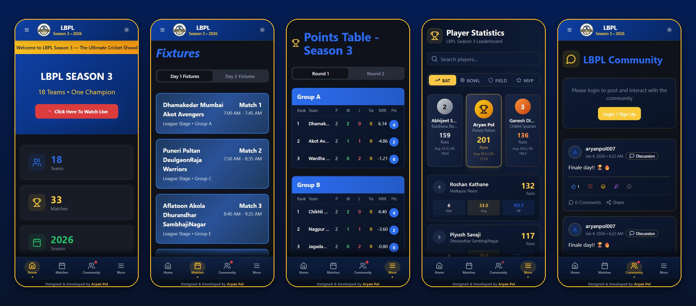

</div>

---

## 📖 About

LBPL Cricket is the official digital home of the **LBPL tournament**: 18 teams from across Maharashtra competing over 33 matches in Season 3 (2026).

Before the app, scores and standings travelled through forwarded WhatsApp messages and word of mouth, so they were often late or wrong. LBPL Cricket replaced that with **one verified source of truth**. Organizers update matches from an admin panel, and every player, team member and fan sees the same live data on their phone.

It ran in production through the whole of Season 3. **Players, team members, organizers and supporters** used it to follow matches live, check qualification scenarios, find their stats and talk with other fans in the community feed.

<!-- Add your real usage numbers here, e.g. "1,200+ users · 400+ installs · 4.8★ in-app rating" -->

> **Why it matters:** it installs like a native app without the Play Store or App Store, uses almost no phone storage, works on Android, iPhone and desktop, and stays usable on slow match-ground internet.

---

## ✨ Features

### 🏏 Match Centre
| | |
|---|---|
| **Live scores** | Ongoing matches with runs, wickets, overs and match status. Updates arrive in real time through Supabase Realtime subscriptions. |
| **Live ticker** | A scrolling banner across the top of the app with live scores and announcements. It refreshes every 30 seconds. |
| **YouTube live stream** | A one-tap **"Click Here To Watch Live"** button on the home screen opens the live stream, which organizers set from the admin panel. |
| **Match timeline** | A swipeable timeline of every match in the season (League Stage → Round 2 → Semi-Finals → Grand Final) with status badges. |
| **Countdown timer** | Counts down to the next scheduled match. |
| **AI win probability** | A live win-probability bar for each team. A Supabase Edge Function sends the current run rate, required run rate and wickets to **Gemini 2.5 Flash** and gets back an estimate. |
| **Full scorecards** | Batting and bowling cards for each innings, shown in match-detail dialogs. |

### 📅 Fixtures & Results
- **Fixtures**: the complete schedule split into Day 1 / Day 2, with match number, time slot, stage and group.
- **Match results**: final scores, winner, result summary (won by runs or wickets) and **Player of the Match**, filterable by **League Phase · Knockouts · Semi-Finals · Grand Final**.

### 📊 Points Table
- Group-wise standings (Groups A–F) for **Round 1 and Round 2**.
- P / W / L / Tie / **NRR** / Pts, updated after every match.
- Database triggers keep team names in the points table in sync when a team is edited.

### 👥 Teams & Squads
- Every participating team with its logo and home town.
- Search across **teams and players**.
- Team detail sheet listing the **Captain, Vice-Captain and full squad**.

### 📈 Player Statistics & Leaderboards
- Leaderboards with four tabs: **BAT · BOWL · FIELD · MVP**.
- A podium for the top 3, then ranked cards with matches, average and strike rate.
- **MVP points** formula: `runs × 1 + wickets × 25 + catches × 10 + stumpings × 10`.
- Player search and player profile dialogs.

### 🏆 Season Hub, Hall of Fame & Archive
- **Season Hub**: a landing page that features the current season and links to every past and upcoming one.
- **Config-driven seasons**: a new season is added by appending one object to `src/config/seasons.ts`, with no UI changes. Seasons without data yet show "Coming Soon" placeholders.
- **Hall of Fame**: computed records for each season, including champion, runner-up, most runs, most wickets, most sixes, highest score, best bowling, fastest fifty, best economy and most POTM awards.
- **Archive**: every completed season kept browsable.

### 💬 Fan Community
- **Passwordless email OTP login** (see [Security](#-security--reliability)). Users stay signed in until they log out.
- A post feed with types: **Discussion · Match Discussion · Question · Announcement · Meme · Poll**.
- **Reactions** (👍 ❤️ 😄 🎉 😢), **comments** and **native share**.
- **AI moderation**: every post goes through a Gemini-powered moderator Edge Function that blocks abuse, hate speech and spam. It can also auto-answer simple common questions.
- **Fan polls and fan leaderboard** to keep supporters engaged.
- A red notification dot on the Community tab when there's new activity.

### 🗳️ Fan Engagement
- **Match prediction polls**: fans vote on who'll win, and the result bars update live.
- **Player of the Match voting**: fans vote for their POTM from the players in that match.
- Database constraints enforce one vote per user, and aggregates come from SQL functions (`get_match_prediction_counts`, `get_potm_vote_counts`).

### 🖼️ Gallery & Sponsors
- A gallery of match photos, team moments and trophy celebrations, managed by admins.
- A sponsors page and section to showcase tournament partners.

### ⚙️ Settings & Personalisation
- **Favourite team**: pick your team.
- **Appearance**: dark mode by default, with a light theme toggle.
- **Notifications**: browser-notification preferences for match-start reminders, wicket alerts, result alerts, community alerts and general updates.
- **Rules, Help, About and Developer** pages.
- **In-app rating**: after 5 sessions the app asks for a rating, with a 7-day cooldown if dismissed.

### 🛠️ Admin Panel
- An admin-only route (`/admin`) protected by **role-based access** (`user_roles` table + `has_role()` SQL function).
- Manage **Teams · Points Table · Matches · Gallery** from one dashboard.
- Update live scores, results and the YouTube stream link during a match.
- A **PWA stats card** that tracks app installs.

---

## 📱 Screenshots

<table>
  <tr>
    <td align="center">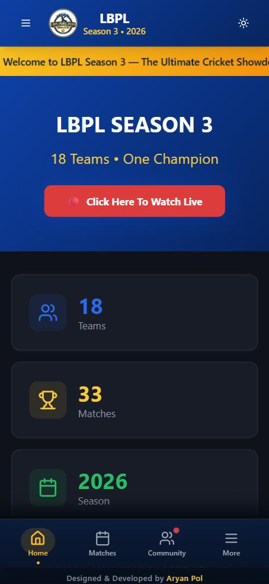<br/><b>Home</b></td>
    <td align="center">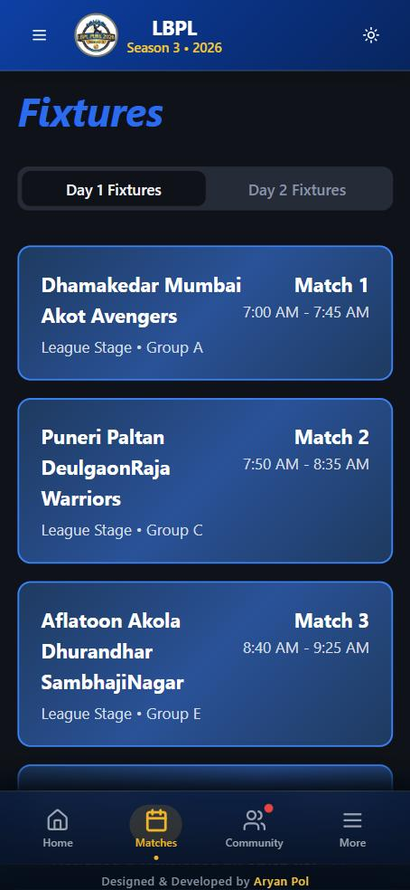<br/><b>Fixtures</b></td>
    <td align="center">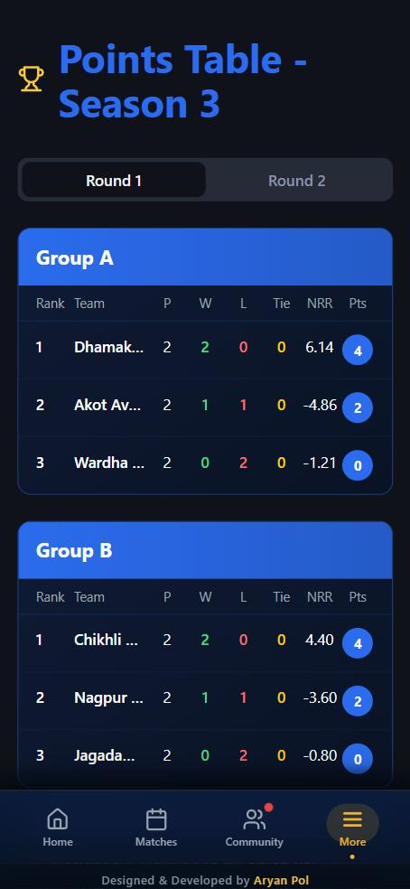<br/><b>Points Table</b></td>
  </tr>
  <tr>
    <td align="center">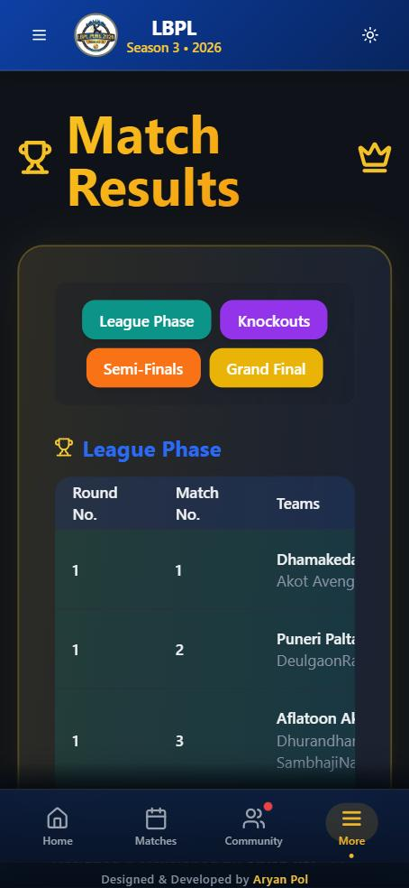<br/><b>Match Results</b></td>
    <td align="center">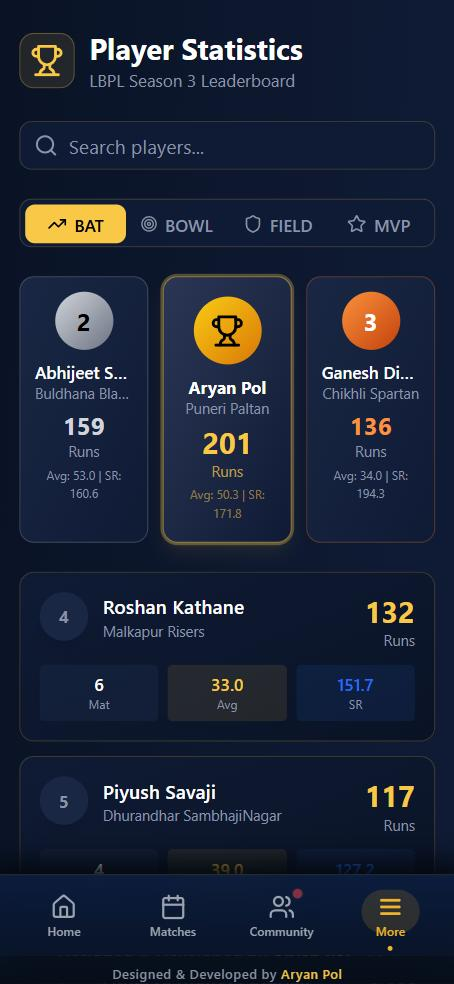<br/><b>Player Stats & Leaderboard</b></td>
    <td align="center">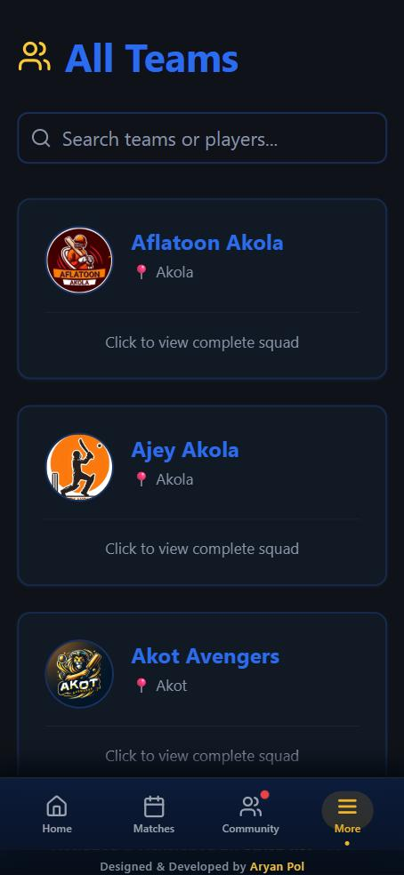<br/><b>All Teams</b></td>
  </tr>
  <tr>
    <td align="center">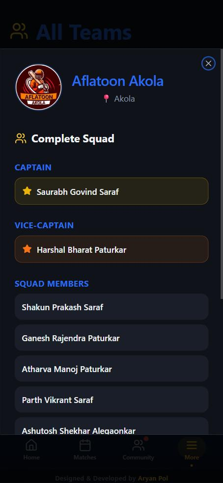<br/><b>Team Squad</b></td>
    <td align="center">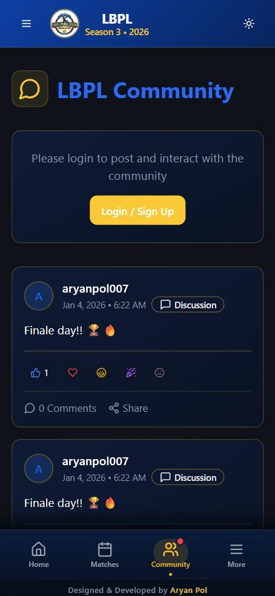<br/><b>Fan Community</b></td>
    <td align="center">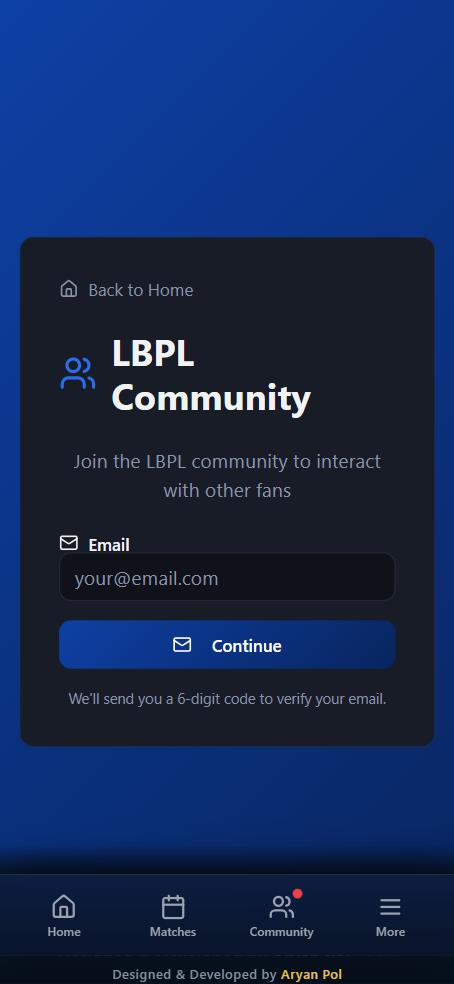<br/><b>Email OTP Login</b></td>
  </tr>
</table>

<div align="center">
  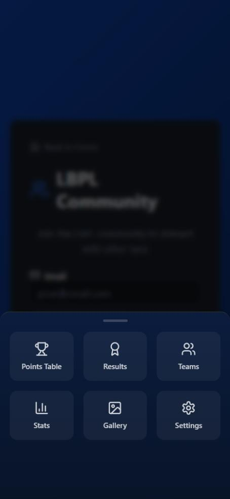
  <br/><b>App-style bottom navigation & "More" sheet</b>
  <br/><br/>
  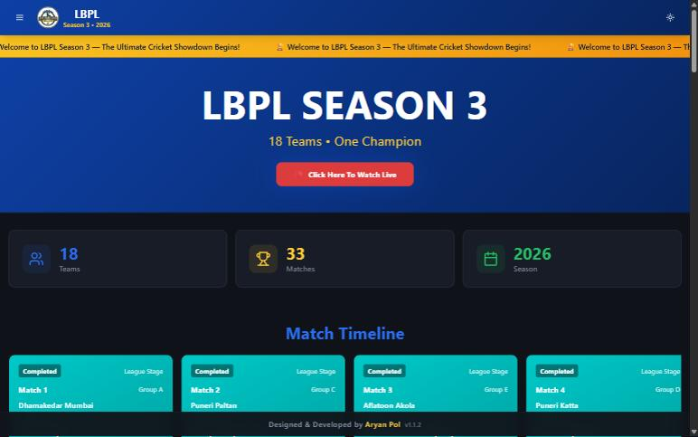
  <br/><b>Desktop view</b>
</div>

---

## 📲 Install the App

No app store needed. LBPL Cricket is a **Progressive Web App**.

| Android (Chrome) | iPhone (Safari) |
|---|---|
| 1. Open [lbplofficial.com](https://lbplofficial.com) | 1. Open [lbplofficial.com](https://lbplofficial.com) |
| 2. Tap **Install app** / **Add to Home Screen** | 2. Tap the **Share** button |
| 3. The LBPL icon appears on your home screen | 3. Choose **Add to Home Screen** |

Once installed it opens full-screen with no browser bar, uses a bottom tab bar like a native app, and loads faster thanks to the service worker cache.

---

## 🧱 Tech Stack

| Layer | Technology |
|---|---|
| **Frontend** | React 18, TypeScript, Vite, React Router v7 |
| **UI** | Tailwind CSS, shadcn/ui (Radix primitives), Lucide icons, Embla carousel, Recharts |
| **State / data** | TanStack Query, React Hook Form + Zod |
| **Backend** | Supabase (PostgreSQL, Auth, Realtime, Storage, Row Level Security) |
| **Serverless** | Supabase Edge Functions (Deno) |
| **AI** | Google Gemini 2.5 Flash / Flash-Lite (win probability + content moderation) |
| **Email** | Resend (OTP delivery) |
| **PWA** | Web App Manifest + custom service worker |
| **Hosting** | Custom domain: [lbplofficial.com](https://lbplofficial.com) |

---

## 🏗️ Architecture

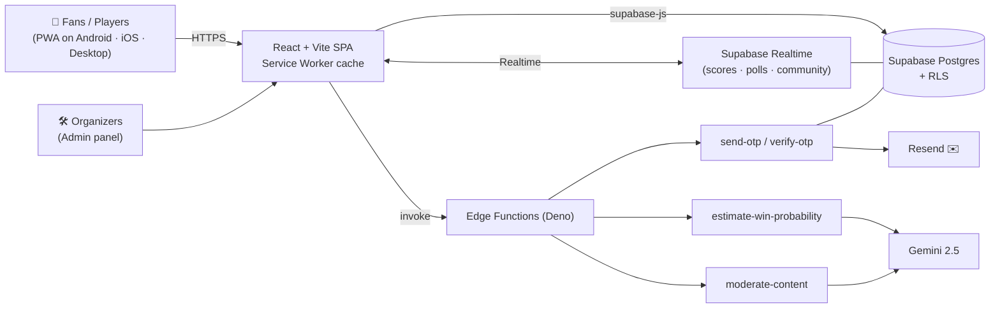

### Database (Supabase / PostgreSQL)

| Domain | Tables |
|---|---|
| Tournament | `teams`, `players`, `matches`, `match_scorecards`, `points_table`, `tournament_settings` |
| Fan engagement | `match_predictions`, `potm_votes`, `fan_polls`, `fan_poll_options`, `fan_poll_votes`, `fan_leaderboard` |
| Community | `community_posts`, `community_comments`, `community_reactions` |
| Auth & roles | `email_otps`, `user_roles` |
| Media & analytics | `gallery_images`, `pwa_installs`, `site_stats`, `app_ratings` |

39 versioned SQL migrations live in [`supabase/migrations`](supabase/migrations).

### Edge Functions

| Function | Purpose |
|---|---|
| `send-otp` | Generates a 6-digit code, stores it with a 5-minute expiry, emails it via Resend. Rate-limited to 1 OTP per minute per email. |
| `verify-otp` | Validates the code and signs the user in. Locks the email for 15 minutes after 5 failed attempts. |
| `estimate-win-probability` | Turns live match state (run rate, required rate, wickets) into a win percentage using Gemini. Falls back gracefully if the AI call fails. |
| `moderate-content` | Classifies community posts as acceptable or not, with a short reason, and optionally returns an auto-reply. |

---

## 🔒 Security & Reliability

- **Passwordless auth**: email OTP with expiry, per-email rate limiting and brute-force lockout.
- **Row Level Security** on Supabase tables. Admin actions require the `admin` role, checked server-side with `has_role()`.
- **Write-only ratings**: app ratings can be inserted but not read back by clients, for privacy.
- **One vote per user**, enforced by database constraints, not just the UI.
- **AI moderation** before community content is published.
- **Offline-friendly service worker** that uses a different cache strategy for each kind of request:
  - Images: cache-first
  - JS/CSS: stale-while-revalidate
  - API and navigation: network-first with cache fallback
- **Error boundary** so a single broken component can't crash the whole app.

---

## 📂 Project Structure

```
LBPLCricket/
├── public/
│   ├── manifest.json          # PWA manifest
│   ├── service-worker.js      # Caching strategies
│   ├── team-logos/            # 18 team logos
│   └── gallery/               # Gallery images
├── src/
│   ├── pages/                 # Route pages (Home, Matches, Results, PointsTable, Teams,
│   │   │                      #   Stats, Community, HallOfFame, Archive, Admin, Auth, ...)
│   │   ├── settings/          # Settings sub-pages (Favourite team, Rules, Help, About, ...)
│   │   └── widget/            # Live score widget
│   ├── components/            # Feature components (LiveScoreboard, WinProbabilityBar,
│   │   │                      #   MatchPredictionPoll, PlayerOfMatchVoting, ScorecardView, ...)
│   │   ├── ui/                # shadcn/ui primitives
│   │   ├── admin/             # Admin widgets
│   │   └── season/            # Season cards
│   ├── config/seasons.ts      # Config-driven multi-season setup
│   ├── context/               # SeasonContext
│   ├── hooks/                 # Theme, notifications, animations, ...
│   ├── lib/                   # Match utils, Hall of Fame calculations
│   └── integrations/supabase/ # Typed Supabase client
└── supabase/
    ├── functions/             # Edge Functions (OTP, AI win probability, moderation)
    └── migrations/            # SQL schema history
```

---

## 🚀 Getting Started

### Prerequisites
- Node.js 18+ and npm
- A Supabase project (for your own backend)

### Setup

```bash
# 1. Clone
git clone https://github.com/aryanpol73/LBPLCricket.git
cd LBPLCricket

# 2. Install dependencies
npm install

# 3. Configure environment
# Create a .env file with your Supabase project values:
#   VITE_SUPABASE_URL=https://<project-id>.supabase.co
#   VITE_SUPABASE_PUBLISHABLE_KEY=<anon-public-key>
#   VITE_SUPABASE_PROJECT_ID=<project-id>

# 4. Run locally
npm run dev
```

### Backend (optional, for your own instance)

```bash
supabase link --project-ref <project-id>
supabase db push                                   # apply migrations
supabase functions deploy send-otp verify-otp estimate-win-probability moderate-content
supabase secrets set RESEND_API_KEY=<key>          # and LOVABLE_API_KEY for the AI gateway
```

### Scripts

| Command | Description |
|---|---|
| `npm run dev` | Start the dev server |
| `npm run build` | Production build |
| `npm run preview` | Preview the production build |
| `npm run lint` | Run ESLint |

---

## 🗺️ Roadmap

- [ ] Season 4 (2027): fixtures, teams and squads
- [ ] Push notifications for wickets and results
- [ ] Ball-by-ball commentary
- [ ] Highlights from match live-stream footage
- [ ] Multi-tournament support for other local leagues

---

## 👨‍💻 Author

**Aryan Pol**: designed, developed and runs LBPL Cricket.

- GitHub: [@aryanpol73](https://github.com/aryanpol73)
- Support / feedback: aryan.pol737@gmail.com

<div align="center">

<br/>

**If you like this project, consider giving it a ⭐**

*Built for the LBPL community, to make local cricket feel big-league.* 🏏

</div>
